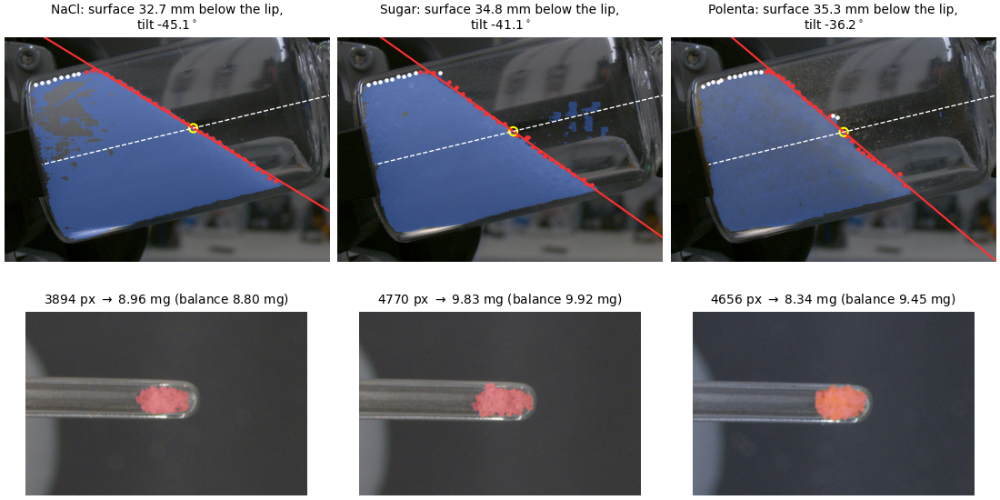

# Quantitative vision for solid sampling at the milligram scale

This repository estimates two quantities from camera images during robotic solid sampling: the height and tilt of the
material surface in a vial, from a side view, and the mass on the spatula after a scoop, from a top view. It also holds
the code and data that reproduce the numbers, tables and data figures of the paper:

> J. Hermus, J. Tan, S. Calinon, P. Miéville and E. Senft, "Quantitative Vision for Solid Sampling at the Milligram
> Scale", *Advanced Robotics Research*, submitted, 2026.



*Output of `python demo/demo.py`. Top: the side view with the material mask (blue), the fitted surface line and the
vial axis. Bottom: the top view with the material mask (red), its pixel count, and the mass estimate next to the
balance reading.*

## How it works

- **Surface** (`ssvision/surface.py`): a line is fitted by RANSAC to the upper edge of the side-view mask. Two fixed
  pixels on the vial axis and the vial length between them give the scale, so no camera calibration is needed. The
  line gives the depth of the surface below the vial lip and its tilt.
- **Mass** (`ssvision/mass.py`): the pixel count n of the top-view mask gives the mass through m = a n<sup>b</sup>,
  with a and b fitted per material from about 30 scoops weighed on a balance.
- **Masks** (`ssvision/segment.py`, optional): SAM 3, with point prompts in the side view and text prompts in the top
  view, processed as the segmentation service of the paper's runs processed them
  ([`docs/segmentation_service.md`](docs/segmentation_service.md)).

## Install

Python 3.10:

```bash
python3.10 -m venv .venv
source .venv/bin/activate
pip install -r requirements.txt
pip install -e .
```

`requirements.txt` pins the versions the paper's numbers were computed with, which have wheels for Python 3.10 to
3.13. On another version, pip builds numpy and scipy from source, which needs compilers and a BLAS library (on Debian
and Ubuntu, `sudo apt-get install -y libopenblas-dev`). On Linux without a desktop, OpenCV also needs `libgl1`
(`sudo apt-get install -y libgl1`).

## Demo

```bash
python demo/demo.py
```

For one stored trial per material, it prints the surface and mass estimates next to the balance reading, and draws
the figure above to `demo/out/demo.png`:

```
NaCl, trial 6 (s_z = +5.0 mm)
  surface  32.69 mm below the lip (21.31 mm above the vial floor), tilt -45.08 deg
  mass     3894 px -> 8.96 mg (a = 2.1590e-04, b = 1.2863); the balance measured 8.80 mg
```

Three more scripts show each step: `estimate_surface.py --plot` (the surface estimate), `estimate_mass.py --plot` (the
mass estimate and its leave-one-out value) and `calibrate_mass.py` (a and b of the three materials, Table 4 of the
paper). `demo/expected/` holds the output of each script.

```bash
python demo/estimate_surface.py --plot
python demo/estimate_mass.py --plot
python demo/calibrate_mass.py
```

### With SAM 3 (optional)

With `--sam3`, the two estimate scripts first recompute the masks from the full camera frames with SAM 3. This needs
the frames (17 MB), torch, torchvision and transformers, and access to the gated `facebook/sam3` weights on Hugging
Face:

```bash
python scripts/download_data.py demo
pip install -e ".[sam3]"
hf auth login
python demo/estimate_mass.py --sam3
python demo/estimate_surface.py --sam3
```

SAM 3 is not part of this repository and has its own licence. The recomputed masks are close to the stored ones but
not identical; [`docs/segmentation_service.md`](docs/segmentation_service.md) compares them.

## Use on your own material

1. **Cameras.** Fix a side camera whose line of sight lies in the material surface, and a top camera above a spatula
   pose that the robot passes after each scoop.
2. **Surface.** Choose two reference pixels on the vial axis, the first at the lip end, and measure the vial length
   between them. For SAM 3, choose a positive point where material always is and a negative point where it never is.

   ```python
   from ssvision.surface import estimate_surface
   from ssvision.segment import side_view_mask

   mask, _ = side_view_mask(side_rgb, positive=(638, 718), negative=(1198, 272))
   res = estimate_surface(mask, vial_clicks=[(1649, 311), (448, 600)], vial_length_mm=57.0)
   print(res["depth_mm"], res["tilt_deg"])
   ```
3. **Prompt.** On frames from a short pilot, `screen_prompt` gives the margin of a candidate phrasing between frames
   with material on the spatula and frames with an empty spatula. Keep the phrasing with the largest positive margin.

   ```python
   from ssvision.segment import screen_prompt
   print(screen_prompt(frames_with_material, empty_frames, "yellow material on the scoop")["margin"])
   ```
4. **Calibrate.** Weigh about 30 scoops over the range of masses you need, leaving out empty scoops and scoops without
   a mask. Save each scoop's pixel count and balance mass in a CSV with the columns `pixel_count` and `mass_mg`, then
   fit a and b:

   ```bash
   python demo/calibrate_mass.py my_scoops.csv --plot --out my_material.json
   ```
5. **Estimate** the mass of a new scoop:

   ```python
   from ssvision.mass import mass_from_pixels, pixel_count
   from ssvision.segment import top_view_mask

   mask, _ = top_view_mask(top_rgb, prompts=("scoop", "yellow material on the scoop"))
   m = mass_from_pixels(pixel_count(mask), a, b)
   ```

The parameters a and b depend on the cameras, the spatula and the material, so each material needs its own fit.

## Reproduce the paper

```bash
python paper/reproduce.py
```

It runs the analysis scripts, compares each printed number with `paper/expected/make_all.txt`, and redraws the data
figures. It takes about 20 s and ends with "the numbers match the expected output". Figure 5 also needs the run
logs (`python scripts/download_data.py runs`). [`paper/README.md`](paper/README.md) maps each script to the paper.

## Tests

After `pip install -e ".[test]"`, `pytest` runs the demo and `paper/reproduce.py` against their expected output, as
GitHub Actions does on every push. Before each commit, `pre-commit` runs ruff and a few file checks: install it once
with `pip install pre-commit`, then `pre-commit install`.

## Data

- **In this repository:** the demo data (`demo/data/`) and the trial-level data of the paper (`paper/data/`).
- **In the Zenodo record** ([doi:10.5281/zenodo.XXXXXXX](https://doi.org/10.5281/zenodo.XXXXXXX)): the run logs of
  the three runs, with the camera images and SAM 3 masks the analysis uses (three zarr stores, about 0.35 GB each),
  the full frames of the demo trials, and a copy of the trial-level data. `python scripts/download_data.py all`
  downloads them into place.
- **The human demonstrations** that trained the scooping action, and its code:
  [github.com/swisscatplus/arms_tplqt](https://github.com/swisscatplus/arms_tplqt).

## Citation

Please cite the paper (`CITATION.cff`), and the Zenodo record when you use the run logs.

This work was supported by Innosuisse (Innovation Project 120.233 IP-ENG). Contact: James Hermus,
james.hermus@idiap.ch.
